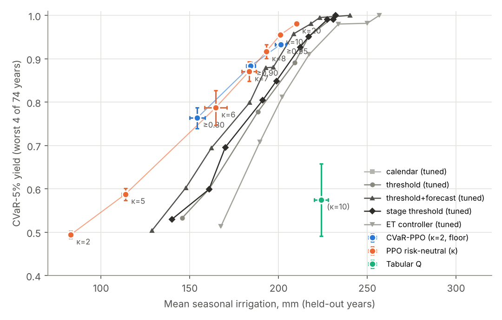
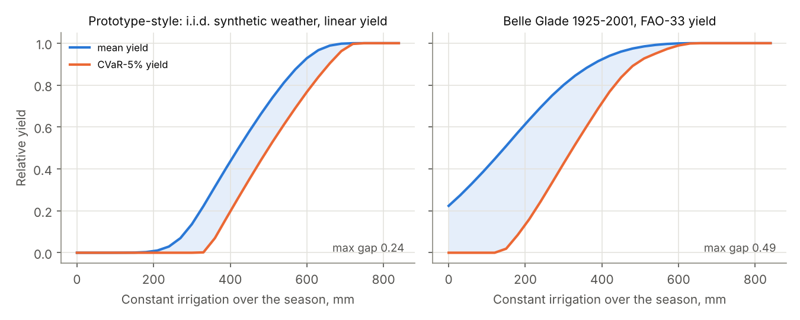
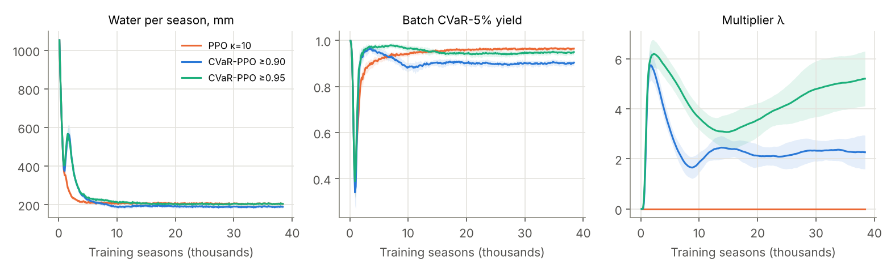

# Tailwater

**Risk-constrained reinforcement learning for irrigation scheduling.**
Aryan Bhagat · FAU · CAP 6629 Reinforcement Learning (Dr. Zhen Ni), Fall 2026 · final project (Option 2).

> Can an RL agent minimise irrigation water subject to an explicit constraint on
> worst-case yield, and how much water does that reliability cost?

Most irrigation-RL work optimises the *average* season. A grower's risk is the bad
season, so this project constrains the **CVaR-5% of yield** (the mean of the worst
5% of seasons) with a Lagrange multiplier that rises automatically when the tail
falls below a floor. Everything is evaluated on 74 real springs (1925–2001) at Belle
Glade, Florida, against baselines tuned on the same training years.

**Live demo:** `docs/index.html` is a self-contained page. To serve it, enable
GitHub Pages (Settings → Pages → deploy from `main`, folder `/docs`). It covers a
season race on any year, the water-versus-tail frontier, a rule you can tune
yourself, and the trained network's policy map. The simulator runs in the browser
as a JavaScript port that `site/check_sim.js` verifies against the Python
implementation season by season.



## Results

The full tables are in [`results/summary.md`](results/summary.md), generated by
`experiments/run_frontier.py`. Every number is on **held-out years** (4-fold
cross-validation by calendar year), and every agent number is a **mean ± sd over 5
training seeds**.

### Findings

1. **Learned policies beat every tuned rule at equal reliability, on held-out years.**
   At the same worst-5% yield, PPO needs less water than the envelope of all tuned
   rule families in all 5 seeds. The saving is 7.5 ± 0.7 mm at CVaR 0.955 and up to
   about 25 mm around CVaR 0.76–0.79. The rules beaten include ones that use the
   same stage sensitivity and rain forecast as the agent.
2. **The CVaR constraint works as a control, but it does not move the frontier.**
   With water priced high (κ = 2), an unconstrained agent's worst-5% yield collapses
   to 0.49. Adding a floor makes λ rise until the tail is protected, and the floor
   sets where the agent lands. However, an unconstrained agent with a tuned crop
   value κ reaches the same points (±5 mm). A plausible reason is that drought is
   visible in the state: a closed-loop policy already irrigates more in dry years,
   so the mean-optimal policy largely protects the tail as well. The constraint's
   practical value is that the grower states a yield floor directly instead of a
   crop price.
3. **Held-out tails fall 0.02–0.04 short of the training floors**
   (0.764 / 0.883 / 0.933 for floors 0.80 / 0.90 / 0.95). A deployed controller
   would need a safety margin.
4. **Tabular Q-learning does not match a tuned rule.** It needs about 81 mm more
   water than the rule envelope at its tail, because the discretised table overfits
   the roughly 55 training seasons per fold.
5. **Real weather creates the tail.** On a constant-rate sweep, the maximum gap
   between mean and CVaR-5% yield is 0.49 on the NOAA record versus 0.24 on i.i.d.
   synthetic weather.

| Agent | Water (mm) | Mean yield | CVaR-5% yield | Saved vs tuned rules* | Saved vs risk-neutral PPO* |
|---|---|---|---|---|---|
| Tabular Q, κ=10 | 224 ± 3.9 | 0.924 ± 0.011 | 0.575 ± 0.083 | -80.8 ± 14.4 (0/5) | – |
| PPO, κ=2 | 83 ± 0.9 | 0.739 ± 0.004 | 0.494 ± 0.008 | +43.5 ± 1.7 (5/5) | – |
| PPO, κ=5 | 114 ± 1.9 | 0.832 ± 0.006 | 0.588 ± 0.014 | +33.6 ± 1.6 (5/5) | – |
| PPO, κ=6 | 165 ± 6.3 | 0.924 ± 0.012 | 0.787 ± 0.040 | +19.5 ± 3.4 (5/5) | – |
| PPO, κ=7 | 183 ± 4.0 | 0.957 ± 0.008 | 0.870 ± 0.022 | +11.5 ± 2.8 (5/5) | – |
| PPO, κ=8 | 193 ± 1.5 | 0.973 ± 0.005 | 0.917 ± 0.016 | +9.4 ± 1.5 (5/5) | – |
| PPO, κ=10 | 201 ± 1.6 | 0.985 ± 0.002 | 0.955 ± 0.006 | +7.5 ± 0.7 (5/5) | – |
| PPO, κ=20 | 210 ± 1.2 | 0.995 ± 0.001 | 0.981 ± 0.003 | +8.1 ± 1.2 (5/5) | – |
| CVaR-PPO, floor 0.80 | 154 ± 4.3 | 0.906 ± 0.010 | 0.764 ± 0.024 | +24.8 ± 1.4 (5/5) | +4.3 ± 2.2 (5/5) |
| CVaR-PPO, floor 0.90 | 184 ± 2.5 | 0.961 ± 0.005 | 0.883 ± 0.009 | +11.8 ± 1.0 (5/5) | +1.7 ± 0.7 (5/5) |
| CVaR-PPO, floor 0.95 | 201 ± 3.0 | 0.984 ± 0.004 | 0.933 ± 0.008 | +3.7 ± 2.3 (5/5) | -4.7 ± 2.2 (0/5) |

\* mm of water saved at the agent's held-out CVaR-5% yield, relative to the Pareto
envelope (linearly interpolated) of all tuned baselines, or of the risk-neutral PPO
runs (κ = 2…20). Mean ± sd over seeds (seeds with a positive saving). The κ = 2 and
κ = 5 comparisons fall below the lowest tuned floor (0.5), where the envelope runs
from the rain-fed point.





## How it works

| Component | Definition |
|---|---|
| Season | 120 days, 1 March – 28 June, spring maize |
| State | soil water, day/stage, 3-day rain forecast, days since rain, yesterday's ET0/ETc |
| Actions | irrigate 0, 5, 10 or 20 mm |
| Water balance | FAO-56 single-bucket root zone (TAW 100 mm, p = 0.5); drainage above field capacity; uptake reduced by Ks below the stress point. Conserves to about 1e-13 mm (tested). |
| Weather | NOAA GHCN-Daily PRCP/TMAX/TMIN, station USC00080611; ET0 by Hargreaves–Samani |
| Yield | FAO-33 multiplicative stage model, `Π (1 − Ky_s (1 − ETa_s/ETm_s))`, maize Ky = 0.4 / 0.4 / 1.5 / 0.5 / 0.2 |
| Objective | `κ·Y − W/100` (κ = crop value in units of 100 mm water) |
| Constraint | `CVaR_5%(Y) ≥ floor` via the Rockafellar–Uryasev form; λ updated by projected dual ascent on the batch CVaR |
| Agents | tabular Q-learning (discretised state); PPO (numpy MLP 64×64, GAE) with and without the CVaR Lagrangian |
| Baselines | rain-fed, fixed calendar, threshold, threshold + forecast, stage threshold (regulated deficit), ET checkbook controller. Each one is swept over its parameter grid and tuned per fold on training years. |

The agents' rewards are dense: each day's linearised FAO-33 yield loss is charged
as it happens, plus an exact harvest correction, so a season's rewards sum to
exactly `−W/100 + κ(Y−1) + (λ/α)·min(Y − VaR, 0)` (tested in
`tests/test_agents.py`).

## Repository layout

```
src/tailwater/
  env/        water_balance.py · crop.py · yield_model.py · weather.py · irrigation_env.py
  policies/   baselines.py (all parameterised) · tuning.py (sweep / select / pareto)
  agents/     tabular_q.py · ppo.py · cvar_lagrangian.py · nn.py · common.py
  eval/       protocol.py (folds, identical weather, multi-seed) · metrics.py
tests/        conservation, published reference values, baselines, agents (pytest)
experiments/  run_diagnostics · run_baseline_sweep · run_agents · run_robustness · run_frontier · export_site
results/      JSON results, summary.md, figures/, models/ (trimmed PPO weights; full set is gitignored)
site/         template.html + sim.js (JS port of the simulator, checked against Python)
docs/         built static site (GitHub Pages ready)
app/          streamlit_app.py
data/         README.md (how to fetch the NOAA file; raw data is gitignored)
```

## Reproduce

```bash
pip install -r requirements.txt
python scripts/fetch_noaa.py                 # ~7 MB from NOAA's AWS mirror
python -m pytest                             # 30 tests, ~5 s
cd experiments
python run_diagnostics.py                    # weather variability, rate sweeps, ET0 vs pan
python run_baseline_sweep.py                 # every baseline family, tuned per fold
python run_agents.py                         # 11 configs x 4 folds x 5 seeds (~65 min, 4 cores)
python run_robustness.py                     # climate wetness and forecast-noise sweeps
python run_frontier.py                       # figures + results/summary.md
python export_site.py && node ../site/check_sim.js   # build docs/index.html, verify JS port
streamlit run ../app/streamlit_app.py        # optional local app
```

## Corrections to the prototype

The project brief recorded two problems with the first prototype. This rebuild
addresses both.

1. **Untuned baseline.** The prototype's "32% saving" came from comparing against an
   ET controller whose trigger had never been tuned. Here every baseline family is
   swept, the least-water member meeting each reliability floor is selected on
   training years only, and it is scored on held-out years. That claim is not
   repeated anywhere in this project.
2. **No yield tail.** The prototype drew each day's weather independently, so season
   totals barely varied and there were no drought years. With the NOAA record, the
   gap between mean and CVaR-5% yield on a constant-rate sweep roughly doubles
   (`results/figures/rate_sweep.png`).

## Limitations

* Hargreaves ET0 comes out at about 0.95× the station's Class-A pan evaporation,
  where reference ET is usually 0.65–0.85× pan, so absolute water amounts are
  probably too high. All controllers share the same ET0, so comparisons between them
  are unaffected.
* The soil is a single 100 mm bucket. The forecast is synthetic log-normal noise
  around the observed rain.
* With 74 seasons, CVaR-5% is the mean of the worst 4. Tail estimates are therefore
  coarse; seed standard deviations are reported for that reason.
* The prototype's code was not available, so this is a rebuild from the brief's
  specification. Prototype numbers quoted in the brief are not reproduced here.

## References

Allen, R. G., Pereira, L. S., Raes, D., & Smith, M. (1998). *Crop evapotranspiration* (FAO Irrigation and Drainage Paper 56).
Chow, Y., Ghavamzadeh, M., Janson, L., & Pavone, M. (2017). Risk-constrained reinforcement learning with percentile risk criteria. *JMLR* 18(167).
Doorenbos, J., & Kassam, A. H. (1979). *Yield response to water* (FAO Irrigation and Drainage Paper 33).
Hargreaves, G. H., & Samani, Z. A. (1985). Reference crop evapotranspiration from temperature. *Applied Engineering in Agriculture* 1(2), 96–99.
Rockafellar, R. T., & Uryasev, S. (2000). Optimization of conditional value-at-risk. *Journal of Risk* 2, 21–42.
Schulman, J., Wolski, F., Dhariwal, P., Radford, A., & Klimov, O. (2017). Proximal policy optimization algorithms. arXiv:1707.06347.
