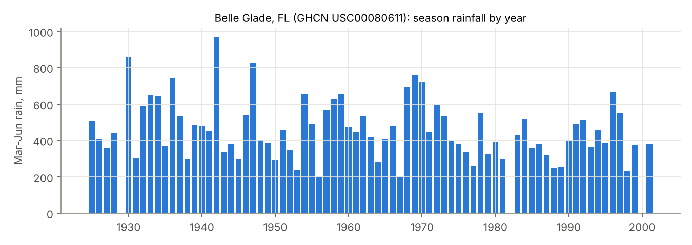

**Source code:** <https://github.com/Aryanbhagat23/tailwater>
(includes a Google Colab / Jupyter notebook, `notebooks/tailwater_colab.ipynb`).

**Abstract.** Irrigation controllers decide every day how much water to apply. A
controller that saves water on average but occasionally starves the crop is of
little use to a grower, because the cost of a bad season is a lost crop. This
project formulates daily irrigation of spring maize as a Markov decision process
and trains reinforcement-learning (RL) agents to minimize water use subject to a
constraint on the Conditional Value-at-Risk (CVaR) of yield: the average yield of
the worst 5% of seasons must stay above a floor. The constraint is enforced with
a Lagrange multiplier that rises automatically when the tail is violated. Agents
are trained and evaluated on 74 real growing seasons (1925–2001) from NOAA's
weather record at Belle Glade, Florida, using year-blocked cross-validation.
They are compared with six families of rule-based controllers, each tuned on the
same training years. On held-out years, Proximal Policy Optimization (PPO) agents
need 4–25 mm less water per season than the best tuned rule with the same
worst-5% yield, in every training seed. The CVaR multiplier works as designed: it
raises the worst-season yield from 0.49 to close to the requested level. However, an
unconstrained agent with a tuned crop price reaches the same water–reliability
trade-off (within ±5 mm), so in this problem the constraint is a more convenient
control, not a more efficient one. Tabular Q-learning fails to match a tuned rule.

# 1. Introduction and Background

## 1.1 Motivation

Agriculture accounts for roughly 80% of consumptive water use in the United States
(USDA Economic Research Service, 2024). Most irrigation is still scheduled by fixed
calendars, soil-moisture thresholds, or evapotranspiration (ET) "checkbook"
controllers that replace the water the crop is estimated to have used. These rules
are simple and reliable, but they do not anticipate rain and do not account for
the crop being far more sensitive to water stress in some growth stages than in
others.

RL is a natural fit for this problem. Irrigation is a sequential decision under
uncertainty: today's decision changes the soil water available tomorrow, the
weather is stochastic, and the payoff (yield) is only observed at harvest. Recent
studies have applied deep RL to irrigation scheduling and reported water savings
relative to their baselines (Yang et al., 2020; Chen et al., 2021; Alibabaei et
al., 2022).

## 1.2 The gap this project addresses

Published RL irrigation work optimizes the **expected** (average) outcome. A grower
does not experience an average; they experience one season at a time, and the
decision-relevant risk is the bad season, such as a drought year in which a
water-saving policy loses much of the crop. The research question of this project
is therefore:

> *Can an RL agent minimize irrigation water subject to an explicit constraint on
> worst-case yield, and how much water must be spent to buy that reliability?*

## 1.3 Background

**Markov decision processes and RL.** An MDP is a tuple $(S, A, P, R, \gamma)$.
The agent learns a policy $\pi(a \mid s)$ that maximizes expected return
(Sutton & Barto, 2018). Two algorithms from the course are used:

* **Q-learning** (Watkins & Dayan, 1992), a tabular off-policy TD method with
  update $Q(s,a) \leftarrow Q(s,a) + \alpha\,[r + \gamma \max_{a'} Q(s',a') - Q(s,a)]$.
* **Proximal Policy Optimization (PPO)** (Schulman et al., 2017), a policy-gradient
  actor-critic method with a clipped surrogate objective, here with generalized
  advantage estimation (GAE; Schulman et al., 2016).

**Risk measures.** For a random yield $Y$ and level $\alpha$ (here 5%), the
Value-at-Risk $\mathrm{VaR}_\alpha(Y)$ is the $\alpha$-quantile of $Y$, and the
Conditional Value-at-Risk is the mean of the worst $\alpha$ fraction:
$\mathrm{CVaR}_\alpha(Y) = \mathbb{E}[Y \mid Y \le \mathrm{VaR}_\alpha(Y)]$.
Rockafellar and Uryasev (2000) showed that CVaR can be written as an optimization,

$$\mathrm{CVaR}_\alpha(Y) = \max_{\nu}\Big\{\nu - \tfrac{1}{\alpha}\,\mathbb{E}\big[(\nu - Y)^+\big]\Big\},$$

which makes it tractable inside gradient methods (Tamar et al., 2015).
**Constrained MDPs** (Altman, 1999) add constraints on expected costs and are
usually solved with Lagrangian relaxation. Chow et al. (2018) combined the two,
giving policy-gradient algorithms with CVaR constraints whose Lagrange multipliers
are updated by dual ascent. This project applies that idea to irrigation.

**Agronomy.** Crop water use is modeled with the FAO-56 method (Allen et al.,
1998): reference evapotranspiration $ET_0$ times a crop coefficient $K_c$ that
changes over the season, reduced by a water-stress coefficient $K_s$ when the soil
dries. $ET_0$ is computed from daily temperature extremes with the Hargreaves–Samani
equation (Hargreaves & Samani, 1985). Yield response to water deficit follows FAO
Paper 33 (Doorenbos & Kassam, 1979), whose yield-response factors $K_y$ capture
how much more sensitive maize is at flowering ($K_y = 1.5$) than at ripening
($K_y = 0.2$).

## 1.4 Starting point: what was wrong with the first prototype

A first feasibility prototype claimed a 32% water saving over an ET controller.
A review found two problems. First, the baseline's trigger had never been tuned:
a tuned two-parameter threshold rule used less water than the RL agent *and* had
a better worst case. Second, the prototype drew each day's weather independently,
so season totals barely varied, there were no drought years, and there was no
yield tail for a risk constraint to act on. This project was rebuilt from scratch
to fix both problems. The 32% figure is not used anywhere in this report.

# 2. Project Specification

## 2.1 Goals and objectives

1. Build a physically conservative daily soil-water and crop-yield simulator driven
   by real historical weather with inter-annual variability.
2. Implement a CVaR-constrained RL agent (PPO + Lagrange multiplier) and two
   reference agents (risk-neutral PPO and tabular Q-learning).
3. Compare all agents with **tuned** rule-based controllers on **held-out** years,
   averaging over several training seeds.
4. Trace the frontier between water use and worst-case yield, the central result.

## 2.2 Problem statement

A field of spring maize is irrigated for one 120-day season (1 March – 28 June).
Each morning the controller observes the soil and the weather and chooses how much
to irrigate. The goal is to use as little water as possible while keeping the
yield of bad seasons acceptable.

**Formulation as an MDP** (one episode = one season, one step = one day):

| Element | Definition |
|---|---|
| State $s_t$ | soil water available to the crop $S_t$ (mm, 0–100); day $t$ and growth stage; 3-day rain forecast (mm); days since rain; yesterday's $ET_0$ and crop ET |
| Action $a_t$ | irrigate 0, 5, 10 or 20 mm |
| Transition | soil water balance (Section 2.3) driven by the day's observed rain and $ET_0$ |
| Reward | $r_t = -I_t/100 - \kappa\,\ell_t$ (water cost minus crop-value-weighted yield loss; Section 2.4) |
| Horizon | $T = 120$, undiscounted ($\gamma = 1$; the day is part of the state) |

**Input sequence.** The environment is driven by three daily sequences per season:
rain $P_t$ and temperature extremes $T_{max}, T_{min}$ from NOAA GHCN-Daily station
USC00080611 (Belle Glade, FL; Menne et al., 2012), from which $ET_0$ is computed;
and a 3-day rain forecast generated as the observed rain times log-normal noise
(σ = 0.5) plus occasional false alarms. Seventy-four seasons, 1925–2001, pass the
completeness check (at most 6 missing days per variable).

**Output.** A policy that maps the daily state to an irrigation amount. Evaluated
over a season, it yields a daily irrigation schedule, the seasonal water total
$W$, and the relative yield $Y \in [0, 1]$.

## 2.3 Environment model

**Water balance** (FAO-56 single-bucket root zone, total available water
TAW = 100 mm, depletion fraction $p = 0.5$). Each day:

$$S' = S + P_t + I_t - D_t - ET_{a,t},\qquad D_t = \max(0,\,S + P_t + I_t - \mathrm{TAW}),$$

$$ET_{c,t} = K_c(t)\,ET_{0,t},\qquad K_s = \min\!\Big(1,\frac{S}{(1-p)\,\mathrm{TAW}}\Big),\qquad ET_{a,t} = K_s\,ET_{c,t}.$$

Below 50 mm of soil water the crop is under stress. Drainage $D_t$ removes water
above field capacity. Every millimetre is accounted for, and a unit test checks
that the seasonal ledger closes to about $10^{-13}$ mm.

**Crop calendar** (FAO-33 stage lengths scaled to 120 days; FAO-56 maize $K_c$):

| Stage | Days | $K_y$ | $K_c$ |
|---|---|---|---|
| Establishment | 1–20 | 0.4 | 0.30 |
| Vegetative | 21–55 | 0.4 | 0.30 → 1.20 |
| Flowering | 56–73 | **1.5** | 1.20 |
| Yield formation | 74–108 | 0.5 | 1.20 → 0.60 (from day 96) |
| Ripening | 109–120 | 0.2 | → 0.60 |

**Yield** (FAO-33 multiplicative stage model):

$$Y = \prod_{s=1}^{5} \max\!\Big(0,\; 1 - K_{y,s}\Big(1 - \frac{ET_{a,s}}{ET_{m,s}}\Big)\Big),$$

where $ET_{a,s}$ and $ET_{m,s}$ are actual and maximum ET summed over stage $s$. A
20% deficit at flowering costs 30% of the yield; the same deficit at ripening costs 4%.

## 2.4 The risk-constrained objective

With $\kappa$ the value of a full crop in units of 100 mm of water:

$$\max_\pi\; \mathbb{E}\big[\kappa\,Y - W/100\big] \quad \text{s.t.} \quad \mathrm{CVaR}_{5\%}(Y) \ge y_{\min}.$$

Using the Rockafellar–Uryasev form, the Lagrangian adds to each season's return the term

$$\frac{\lambda}{\alpha}\,\min(Y - \nu,\,0),$$

where $\nu$ is the batch's 5% quantile of yield. Only seasons in the tail receive
the extra incentive, scaled by $1/\alpha = 20$. The multiplier is updated by
projected dual ascent on the batch's empirical CVaR,

$$\lambda \leftarrow \mathrm{clip}\big(\lambda + \eta_\lambda\,(y_{\min} - \widehat{\mathrm{CVaR}}),\; 0,\; \lambda_{\max}\big),$$

so it **rises automatically while the worst seasons violate the floor** and decays
once the floor is met.

**Dense rewards.** Yield is only known at harvest. To first order, the FAO-33 loss
decomposes over days, $1 - Y \approx \sum_t \ell_t$ with
$\ell_t = K_{y,s(t)}(ET_{c,t} - ET_{a,t})/ET_{m,s(t)}$. Each day is charged
$-I_t/100 - (\kappa + w)\,\ell_t$, where $w = \lambda/\alpha$ for tail seasons and 0
otherwise. An exact correction at harvest makes the season's rewards sum to
precisely $-W/100 + \kappa(Y-1) + w\,(Y-\nu)$, so shaping changes credit assignment
but not the objective (this identity is unit-tested).

## 2.5 Algorithms (pseudocode)

**Algorithm 1: CVaR-constrained PPO**

```
Input: training seasons D, crop value κ, floor y_min,
       α = 0.05, batch B = 128 seasons, iterations K = 300
Initialise policy π_θ and value V_φ (MLP 12-64-64), λ ← 0
for k = 1..K:
    sample B seasons from D; draw fresh forecast noise
    for t = 1..120:                 # all B fields in parallel
        observe s_t; sample a_t ~ π_θ(·|s_t)
        step the water balance
        record s_t, a_t, log π_θ(a_t|s_t), V_φ(s_t),
               I_t, ETc_t, ETa_t
    compute yields Y_1..Y_B (FAO-33)
    ν ← α-quantile of Y;  tail_i ← [Y_i ≤ ν]
    CVaR ← mean of the worst ⌈αB⌉ yields
    w_i ← (λ/α)·tail_i
    r_{i,t} ← −I_{i,t}/100 − (κ + w_i)·ℓ_{i,t}
    r_{i,120} += κ(Y_i − 1 + L_i) + w_i(Y_i − ν + L_i)
                                    # exact harvest correction
    advantages  by GAE(γ = 1, λ_GAE = 0.95); R̂ ←  + V
    for 4 epochs, minibatches of 2048:
        ρ = π_θ(a|s)/π_old(a|s)
        θ ← θ + ∇θ[min(ρÂ, clip(ρ,0.8,1.2)Â) + c·H(π_θ)]  (Adam)
        φ ← φ − ∇φ (V_φ(s) − R̂)²
    λ ← clip(λ + η_λ (y_min − CVaR), 0, λ_max)   # dual ascent
return π_θ (greedy at evaluation)
```

Risk-neutral PPO is the same algorithm with $\lambda \equiv 0$.

**Algorithm 2: tabular Q-learning (batched)**

```
State bins: soil water (20 × 5 mm) × 10-day period (12)
            × forecast (5) × days since rain (4)
Initialise Q(s, a) ← 0
ε: 0.5 → 0.02 and α: 0.5 → 0.02 over 70% of training
repeat for 40,000 episodes (32 seasons in parallel):
    s ← encode(initial state)
    for t = 1..120:
        a ← ε-greedy(Q[s])
        take a; observe s' and
            r = −I/100 − κ·K_y·(ETc − ETa)/ETm_clim(stage)
        target ← r                       if t = 120
                 r + max_a' Q[s', a']    otherwise
        Q[s, a] ← Q[s, a] + α·mean(target − Q[s, a])
                  (mean over fields that hit the same cell)
        s ← s'
```

**Algorithm 3: evaluation protocol**

```
Split the 74 seasons into 4 folds by calendar year
(fixed random assignment)
for each fold j:
    train ← other 3 folds; test ← fold j
    for each baseline family F and each floor f in {0.5, ..., 1.0}:
        sweep every parameter setting of F on train
        choose the least-water setting with CVaR_5% ≥ f
        on train
        score it on test
    for each agent configuration and seed in {0..4}:
        train the agent on train
        score the greedy policy on test
pool the 4 test folds: every year is scored once,
    by a model that never saw it
report agents as mean ± sd over the 5 seeds
(all policies see identical weather and forecasts)
```

## 2.6 Baselines

Each baseline is a parameterized family. **No hand-picked setting is used in any
comparison**: every family is swept over its grid and re-tuned for each fold and
each reliability floor (Algorithm 3).

| Family | Rule | Grid |
|---|---|---|
| Rain-fed | never irrigate | (none) |
| Fixed calendar | $A$ mm every $k$ days | $k$ 1–10, $A$ ∈ {5,10,20} |
| Threshold | $A$ mm when $S < T$ | $T$ 10–95 mm, $A$ ∈ {5,10,20} |
| Threshold + forecast | as above, skipped when the 3-day forecast ≥ $F$ | + $F$ ∈ {5,10,20,40} mm |
| Stage threshold (regulated deficit) | trigger $T_{hi}$ in flowering/yield formation, $T_{lo}$ otherwise | 18 × 18 × 3 |
| ET controller (commercial practice) | books $K_c\,ET_0 -$ rain; refills a fraction when the deficit ≥ trigger; never sees soil moisture | trigger 5–100 mm, refill ∈ {0.5, 0.75, 1} |

The stage-threshold and threshold+forecast rules are deliberately strong: they use
the same information as the agent (stage sensitivity and the forecast), so any
advantage the agent shows cannot come from information access alone.

## 2.7 Expected solution

Before running the experiments, the expectations were:

1. The water balance conserves water exactly, and real weather produces a wide
   spread between average and worst-5% yield (a "tail").
2. Learned policies can match or beat tuned rules at the same reliability, because
   they can combine stage, forecast and soil water non-linearly.
3. The CVaR multiplier rises when the floor is violated and lets the agent target a
   reliability level directly.
4. **Hypothesis to test:** at matched water use, a CVaR-constrained agent achieves
   a better worst-5% yield than a risk-neutral agent.

# 3. Implementation and Evaluation

## 3.1 Software and verification

All code is Python (NumPy, pandas); PPO is implemented from scratch in NumPy with
manual backpropagation and Adam. The repository has 30 automated tests (pytest),
including:

* **Conservation:** the seasonal ledger (start + rain + irrigation − ET − drainage −
  end) closes to about $10^{-13}$ mm under six different policies.
* **Published reference values:** extraterrestrial radiation matches FAO-56 Example 8
  ($R_a = 32.2$ MJ m⁻² d⁻¹ at 20°S on 3 September); FAO-33 maize $K_y$ values; a 20%
  flowering deficit gives exactly 0.70 relative yield.
* **Algorithm checks:** the MLP gradients match finite differences; the dense
  rewards sum exactly to the Lagrangian objective; the multiplier rises when the
  tail is violated and falls to zero when it is met.

The demo site's JavaScript simulator was also checked against the Python simulator.
It reproduces every one of the 74 seasons exactly (difference 0.0 mm) for all eight
demo policies.

## 3.2 Weather data and the tail

{width=95%}

Spring rainfall ranged from 198 mm (1967) to 969 mm across the 74 seasons. Season
rain has a coefficient of variation (CV) of 0.35, and season $ET_0$ a CV of 0.039,
three times that of the prototype's synthetic generator (0.013).

{width=100%}

Applying a constant daily amount and sweeping it shows why real weather matters
(Figure 2). The worst-5% yield sits up to **0.49** below the average season on the
NOAA record, against 0.24 on i.i.d. synthetic weather. This gap is the tail the
constraint acts on.

**Validation of $ET_0$.** The station also measured Class-A pan evaporation.
Hargreaves $ET_0$ comes out at 0.95× pan over 18,645 days, whereas reference ET is
normally 0.65–0.85× pan. Hargreaves is known to overestimate in humid climates, and
temperature-based methods have been re-evaluated specifically for Florida
(Martinez & Thepadia, 2010). **The absolute water amounts in this report are
therefore probably too high.** Since every controller sees the same $ET_0$,
comparisons between controllers are unaffected.

## 3.3 Tuned baselines

Held-out results of each family, tuned for three reliability floors:

| Baseline (tuned for floor) | Water (mm) | Mean yield | CVaR-5% | Worst |
|---|---|---|---|---|
| Rain-fed | 0 | 0.224 | 0.000 | 0.000 |
| Fixed calendar @ 0.90 | 600 | 0.999 | 0.989 | 0.986 |
| Threshold @ 0.80 | 209 | 0.932 | 0.892 | 0.885 |
| Threshold @ 0.90 / 0.95 | 217 | 0.970 | 0.951 | 0.948 |
| Threshold + forecast @ 0.80 | 184 | 0.898 | 0.799 | 0.769 |
| Threshold + forecast @ 0.90 | 197 | 0.946 | 0.881 | 0.864 |
| Threshold + forecast @ 0.95 | 209 | 0.988 | 0.957 | 0.951 |
| Stage threshold @ 0.80 | 191 | 0.896 | 0.804 | 0.760 |
| Stage threshold @ 0.90 | 212 | 0.959 | 0.927 | 0.916 |
| ET controller @ 0.90 | 217 | 0.949 | 0.910 | 0.904 |
| ET controller @ 0.95 | 234 | 0.995 | 0.980 | 0.971 |

The fixed calendar wastes water. The ET controller, which never sees soil moisture,
needs more water than the threshold rules for a similar tail (for example, 234 mm
against 218 mm for threshold + forecast at a worst-5% yield of about 0.98). The
forecast-aware rule is the cheapest rule at most reliability levels.

## 3.4 Learning curves

{width=100%}

The randomly initialized policy irrigates about 1,000 mm per season. Within about
5,000 training seasons, PPO cuts this to near its final level. For the constrained
agents, λ jumps when the batch tail first falls below the floor, then settles at a
level that holds the tail near the floor: about 2 for floor 0.90, and still rising
at about 5 for floor 0.95. Each run (300 iterations × 128 seasons) takes about
70 s on one CPU core.

## 3.5 Main results: the water–reliability frontier

All 11 agent configurations were trained with 5 seeds on each of 4 folds
(220 training runs). Held-out results, mean ± sd over seeds:

| Agent | Water (mm) | Mean yield | CVaR-5% | Worst |
|---|---|---|---|---|
| Tabular Q, κ=10 | 224 ± 3.9 | 0.924 ± 0.011 | 0.575 ± 0.083 | 0.347 |
| PPO, κ=2 | 83 ± 0.9 | 0.739 ± 0.004 | 0.494 ± 0.008 | 0.459 |
| PPO, κ=5 | 114 ± 1.9 | 0.832 ± 0.006 | 0.588 ± 0.014 | 0.518 |
| PPO, κ=6 | 165 ± 6.3 | 0.924 ± 0.012 | 0.787 ± 0.040 | 0.764 |
| PPO, κ=7 | 183 ± 4.0 | 0.957 ± 0.008 | 0.870 ± 0.022 | 0.853 |
| PPO, κ=8 | 193 ± 1.5 | 0.973 ± 0.005 | 0.917 ± 0.016 | 0.902 |
| PPO, κ=10 | 201 ± 1.6 | 0.985 ± 0.002 | 0.955 ± 0.006 | 0.944 |
| PPO, κ=20 | 210 ± 1.2 | 0.995 ± 0.001 | 0.981 ± 0.003 | 0.968 |
| **CVaR-PPO, κ=2, floor 0.80** | 154 ± 4.3 | 0.906 ± 0.010 | 0.764 ± 0.024 | 0.737 |
| **CVaR-PPO, κ=2, floor 0.90** | 184 ± 2.5 | 0.961 ± 0.005 | 0.883 ± 0.009 | 0.866 |
| **CVaR-PPO, κ=2, floor 0.95** | 201 ± 3.0 | 0.984 ± 0.004 | 0.933 ± 0.008 | 0.922 |

{width=95%}

**Head-to-head comparison.** For each agent and seed, the water a tuned baseline
would need to reach the same held-out worst-5% yield is read off the Pareto envelope
of all tuned baselines (all families, all floors), interpolating linearly between
envelope points. The saving is that water minus the agent's water:

| Agent | Saving vs. tuned rules (mm) | Seeds better | Saving vs. risk-neutral PPO (mm) | Seeds better |
|---|---|---|---|---|
| PPO, κ=10 | +7.5 ± 0.7 | 5/5 | (n/a) | |
| PPO, κ=20 | +8.1 ± 1.2 | 5/5 | (n/a) | |
| CVaR-PPO, floor 0.80 | +24.8 ± 1.4 | 5/5 | +4.3 ± 2.2 | 5/5 |
| CVaR-PPO, floor 0.90 | +11.8 ± 1.0 | 5/5 | +1.7 ± 0.7 | 5/5 |
| CVaR-PPO, floor 0.95 | +3.7 ± 2.3 | 5/5 | −4.7 ± 2.2 | 0/5 |
| Tabular Q, κ=10 | −80.8 ± 14.4 | 0/5 | (n/a) | |

Findings:

1. **PPO beats every tuned rule at the same reliability**, in every seed. The saving
   ranges from 4–8 mm (2–4%) at worst-5% yields of 0.93–0.98 to about 25 mm (14%) at
   0.76.
   The rules beaten include the stage-threshold and forecast-aware rules.
2. **The CVaR multiplier does its job.** With water priced high (κ = 2) and no
   constraint, the agent cuts water to 83 mm and its worst-5% yield collapses to
   0.49. Adding a floor raises λ until the tail is protected, and the floor sets
   where on the frontier the agent lands.
3. **Hypothesis 4 is not supported.** A risk-neutral agent with a suitably chosen κ
   reaches the same points: against the risk-neutral PPO frontier, the constrained
   agents save between −4.7 and +4.3 mm. The constraint selects a point on the same
   frontier rather than moving the frontier. A plausible explanation is that drought
   is visible in the state: a closed-loop policy that watches soil water already
   irrigates more in dry years, so protecting the average season largely protects
   the worst ones. The practical value of the constraint is that a grower can state
   a yield floor directly, instead of searching for the crop price κ that happens to
   produce it.
4. **Held-out tails fall 0.02–0.04 short of the training floor** (0.764, 0.883 and
   0.933 for floors 0.80, 0.90 and 0.95). The floor is enforced on training batches
   drawn from about 55 seasons with the stochastic training policy. A deployed
   controller would need a safety margin.
5. **Tabular Q-learning fails to match a tuned rule.** It needs about 81 mm more
   water than the rule envelope at its tail, with a large seed spread. The
   discretized table, trained on about 55 seasons, overfits; the neural policy
   generalizes far better.

## 3.6 Case study: the 1967 drought

1967 was the driest spring in the record (198 mm of rain, nearly none before day 78).
It belongs to fold 1, so all four controllers below were tuned or trained without it.

{width=100%}

| Controller (1967) | Water (mm) | Yield |
|---|---|---|
| Rain-fed | 0 | 0.00 |
| ET controller (trigger 60, refill 0.5) | 340 | 0.96 |
| Stage threshold (T_lo 40, T_hi 45, 10 mm) | 330 | 0.92 |
| CVaR-PPO, floor 0.90 | **315** | **0.97** |

Without irrigation the soil empties by day 75 and flowering fails completely
(yield 0). The agent starts irrigating earlier than the rules (day 35), keeps soil
water above the stress line through flowering, and irrigates in small frequent
amounts (mostly 5 mm). It reaches the highest yield with the least water.

**Input sequence and output** (agent, days 53–66 of 1967, around the start of flowering):

| Day | Stage | Soil water at dawn (mm) | 3-day forecast (mm) | $ET_0$ (mm) | Rain (mm) | **Action (mm)** | Soil water at dusk (mm) |
|---|---|---|---|---|---|---|---|
| 53 | vegetative | 58.8 | 0.0 | 5.28 | 0 | **5** | 57.8 |
| 54 | vegetative | 57.8 | 0.0 | 5.05 | 0 | **10** | 62.0 |
| 55 | vegetative | 62.0 | 0.0 | 5.39 | 0 | **5** | 60.7 |
| 56 | flowering | 60.7 | 0.0 | 5.95 | 0 | **5** | 58.6 |
| 58 | flowering | 57.1 | 0.0 | 5.33 | 0 | **5** | 55.7 |
| 59 | flowering | 55.7 | 4.9 | 5.91 | 0 | **5** | 53.6 |
| 61 | flowering | 51.7 | 0.0 | 5.02 | 0 | **5** | 50.6 |
| 63 | flowering | 49.5 | 0.0 | 5.25 | 0 | **5** | 48.2 |
| 64 | flowering | 48.2 | 0.0 | 5.57 | 0 | **5** | 46.5 |
| 65 | flowering | 46.5 | 0.0 | 5.66 | 0 | **10** | 49.7 |
| 66 | flowering | 49.7 | 0.0 | 5.31 | 0 | **5** | 48.3 |

When the soil falls to about 46 mm at flowering, the most sensitive stage, the agent
switches from 5 to 10 mm.

## 3.7 What the agent learned: policy map

{width=95%}

The learned policy resembles a stage-dependent threshold rule but differs in
instructive ways (Figure 6):

* It never irrigates during establishment, when crop water use is small ($K_c = 0.3$).
* Its trigger **rises steadily through the vegetative stage**, tracking the rising
  crop coefficient, and peaks at about 78 mm during flowering, well above the
  rule's 45 mm.
* It uses two amounts, 10 mm when the soil is dry and 5 mm for top-ups near the
  trigger, and never chooses 20 mm.
* It stops irrigating late in ripening ($K_y = 0.2$) unless the soil is nearly empty.

## 3.8 Robustness

Policies trained or tuned on the historical record were evaluated on 600 synthetic
seasons per level from a stochastic weather generator fitted to Belle Glade, with
rainfall scaled from 60% to 120% of the fitted climate. No policy was trained or
tuned on these seasons. Cells show water (mm) / worst-5% yield:

| Policy | 60% rain | 80% rain | 100% | 120% rain |
|---|---|---|---|---|
| CVaR-PPO, floor 0.90 | 261 / 0.86 | 209 / 0.87 | 169 / 0.89 | 137 / 0.90 |
| Stage threshold @ 0.90 | 294 / 0.92 | 237 / 0.93 | 194 / 0.93 | 159 / 0.94 |
| Threshold + forecast @ 0.90 | 287 / 0.85 | 225 / 0.85 | 179 / 0.85 | 141 / 0.86 |
| CVaR-PPO, floor 0.95 | 283 / 0.92 | 226 / 0.93 | 183 / 0.93 | 149 / 0.94 |
| ET controller @ 0.95 | 319 / 0.98 | 259 / 0.98 | 214 / 0.98 | 176 / 0.98 |

In drier climates every controller needs more water. The agents remain the most
water-efficient, but their worst-5% yield drifts down slightly as the climate moves
away from the one they were trained on (0.89 → 0.86 for floor 0.90). The rules,
which react only to soil water, keep their tails almost constant. The agents also
held up as the rain forecast got worse: with forecast noise raised from σ = 0 to
σ = 2, the floor-0.90 agent's water rose from 185 to 200 mm while its tail stayed
at 0.89–0.90.

# 4. Summary and Conclusions

This project built a verified irrigation simulator driven by 74 real Florida
growing seasons, and used it to test whether RL can minimize water subject to an
explicit constraint on the yield of the worst 5% of seasons. The conclusions are:

1. **Real weather is essential for risk-aware irrigation research.** The real record
   roughly doubles the gap between average and worst-season yield compared with
   i.i.d. synthetic weather, which is what gives a CVaR constraint something to act on.
2. **Tuning the baselines changes the conclusion.** Against tuned rules, the
   prototype's 32% saving disappears. With proper tuning, held-out evaluation and
   five seeds, PPO still saves 4–25 mm per season over the best tuned rule at the
   same worst-5% yield, consistently across seeds, against rules that use the same
   information.
3. **The CVaR-Lagrangian agent works as a control mechanism**, with λ rising
   automatically when the tail is violated. It does not, however, reach a better
   trade-off than a risk-neutral agent with a tuned crop value. In a closed-loop
   problem where risk shows up in the state, mean-optimal and tail-protecting
   policies largely coincide. This is a negative result for the original hypothesis
   and a useful one: the benefit of the constraint here is interpretability (a
   floor in yield units), not efficiency.
4. **Tabular Q-learning is not sufficient.** With about 55 training seasons it
   overfits and loses to a two-parameter rule.

**Limitations.** Absolute water amounts are likely overestimated (Hargreaves $ET_0$
runs high against pan evaporation). The soil is a single 100 mm bucket. The forecast
is synthetic noise around the observed rain. The tail estimate rests on 74 seasons,
so CVaR-5% is the mean of only the worst 4.

**Future work.** Calibrate $ET_0$ (Penman–Monteith or a pan-calibrated Hargreaves);
use real archived forecasts; build the constraint into the training distribution
(e.g. oversample dry years) so tails hold out of sample; test a crop model with
more stages and soil layers; and study whether CVaR constraints help where risk is
*not* visible in the state (e.g. late-season storms or price shocks).

# 5. References

Alibabaei, K., Gaspar, P. D., Assunção, E., Alirezazadeh, S., & Lima, T. M. (2022).
Irrigation optimization with a deep reinforcement learning model: Case study on a site
in Portugal. *Agricultural Water Management, 263*, 107480.
https://doi.org/10.1016/j.agwat.2022.107480

Allen, R. G., Pereira, L. S., Raes, D., & Smith, M. (1998). *Crop evapotranspiration:
Guidelines for computing crop water requirements* (FAO Irrigation and Drainage Paper
56). Food and Agriculture Organization of the United Nations.

Altman, E. (1999). *Constrained Markov decision processes*. Chapman & Hall/CRC.

Chen, M., Cui, Y., Wang, X., Xie, H., Liu, F., Luo, T., Zheng, S., & Luo, Y. (2021).
A reinforcement learning approach to irrigation decision-making for rice using weather
forecasts. *Agricultural Water Management, 250*, 106838.
https://doi.org/10.1016/j.agwat.2021.106838

Chow, Y., Ghavamzadeh, M., Janson, L., & Pavone, M. (2018). Risk-constrained
reinforcement learning with percentile risk criteria. *Journal of Machine Learning
Research, 18*(167), 1–51.

Doorenbos, J., & Kassam, A. H. (1979). *Yield response to water* (FAO Irrigation and
Drainage Paper 33). Food and Agriculture Organization of the United Nations.

Hargreaves, G. H., & Samani, Z. A. (1985). Reference crop evapotranspiration from
temperature. *Applied Engineering in Agriculture, 1*(2), 96–99.
https://doi.org/10.13031/2013.26773

Martinez, C. J., & Thepadia, M. (2010). Estimating reference evapotranspiration with
minimum data in Florida. *Journal of Irrigation and Drainage Engineering, 136*(7),
494–501. https://doi.org/10.1061/(ASCE)IR.1943-4774.0000214

Menne, M. J., Durre, I., Vose, R. S., Gleason, B. E., & Houston, T. G. (2012). An
overview of the Global Historical Climatology Network-Daily database. *Journal of
Atmospheric and Oceanic Technology, 29*(7), 897–910.
https://doi.org/10.1175/JTECH-D-11-00103.1

Rockafellar, R. T., & Uryasev, S. (2000). Optimization of conditional value-at-risk.
*Journal of Risk, 2*(3), 21–41.

Schulman, J., Moritz, P., Levine, S., Jordan, M., & Abbeel, P. (2016).
High-dimensional continuous control using generalized advantage estimation.
*International Conference on Learning Representations (ICLR)*. arXiv:1506.02438.

Schulman, J., Wolski, F., Dhariwal, P., Radford, A., & Klimov, O. (2017). Proximal
policy optimization algorithms. arXiv:1707.06347.

Sutton, R. S., & Barto, A. G. (2018). *Reinforcement learning: An introduction*
(2nd ed.). MIT Press.

Tamar, A., Glassner, Y., & Mannor, S. (2015). Optimizing the CVaR via sampling.
*Proceedings of the AAAI Conference on Artificial Intelligence, 29*(1).

USDA Economic Research Service. (2024). *Irrigation & water use*. U.S. Department of
Agriculture. https://www.ers.usda.gov/topics/farm-practices-management/irrigation-water-use

Watkins, C. J. C. H., & Dayan, P. (1992). Q-learning. *Machine Learning, 8*(3–4),
279–292. https://doi.org/10.1007/BF00992698

Yang, Y., Hu, J., Porter, D., Marek, T., Heflin, K., & Kong, H. (2020). Deep
reinforcement learning-based irrigation scheduling. *Transactions of the ASABE,
63*(3), 549–556. https://doi.org/10.13031/trans.13633

# Appendix A: AI Usage Declaration

> **[ARYAN, READ BEFORE SUBMITTING]** This declaration must be true. Every
> statement below about what the AI did is accurate. Every bracketed **[TO
> COMPLETE]** item asks about your own work, which only you can answer. Fill
> those in honestly, delete this box, and do not claim any work you did not do.

**Main tool, version and date.** Claude Code (Anthropic), version 2.1.331, running
the model Claude Opus 5.5 (`claude-opus-5-5`), used through claude.ai on the web in
one cloud session from 27 October to 24 November 2026. The tool was connected to
the internet through a restricted network: it could reach GitHub, the Python package
index, NOAA's GHCN-Daily mirror on AWS, and (from 24 November) the Crossref
bibliographic API.

**How it was used.** AI was used for most of the technical work and the writing:

* It wrote all of the source code in the repository: the simulator, weather loader,
  baselines, tabular Q-learning, the NumPy PPO and CVaR-Lagrangian agents, the
  evaluation protocol, the 30 unit tests, the experiment scripts, the figures, the
  Streamlit app and the interactive web demo.
* It downloaded the NOAA data, ran all experiments (220 agent training runs plus
  baseline sweeps and robustness tests) and chose most hyperparameters.
* It drafted this report, including the text, tables, equations and pseudocode, and
  checked eight of the references against Crossref. The remaining references
  (Rockafellar & Uryasev; Tamar et al.; Chow et al.; the two Schulman et al. papers;
  Sutton & Barto; Altman; the FAO papers; USDA ERS) were not machine-verified.
* [TO COMPLETE: anything else, e.g. whether you used AI to understand concepts or
  to write the original project proposal and the prototype review brief]

**Commands and prompts used** (verbatim user prompts, in order):

1. A project brief describing the research question, the MDP formulation, the
   findings of a review of a first prototype, a corrected plan and build
   instructions, ending with: *"can yo give me name for this project so i can make
   repo and yoi can start everyhtin in that"*
2. *"Clone the repository Aryanbhagat23/tailwater into this session."*
3. *"make everyhting again and do eberyhting from begining you can add everything on
   github as you like and give me live working protope or webiste whatever it is"*
4. *"how do i copy it in vs code"*
5. The course's project instruction PDF, with *"i need help witht hsi now can you
   help mw"* (which produced this report draft).

**Key dialogue summary.** The AI proposed the name "Tailwater". It rebuilt the
project from the brief, found NOAA data through the AWS mirror when NOAA's own site
was blocked, and reported findings that went against the original hypothesis. It
flagged when its first idea was wrong: its rebuilt synthetic weather did not
reproduce the prototype's narrow cliff, and Hargreaves $ET_0$ ran high against pan
evaporation. After seeing that the floor-0.95 agent was dominated by a risk-neutral
agent, it added three extra configurations (κ = 6, 7, 8) to test the CVaR
hypothesis fairly, and switched to an interpolated comparison so that neither side
was flattered.

**Comparison with human work: what did AI bring?**

* *Advantages:* speed and scale. A complete, tested code base and 220 training runs
  were produced in about two days of session time, which would take a student far
  longer. It also applied systematic checks: unit tests against published values,
  held-out evaluation, multiple seeds, tuned baselines, and verifying the web
  simulator against Python.
* *Disadvantages and risks:* the AI made modeling choices that a domain expert might
  make differently (season dates, soil capacity of 100 mm, forecast-noise model,
  hyperparameters). Some of its first attempts had errors it later caught: test
  expectations with wrong action indices, a reference-value test based on table
  values it could not verify (removed), and an inconsistent comparison metric
  (replaced). It cannot verify references it has no network access to. Because it
  wrote the code, the student's understanding of the implementation must be checked
  separately; an AI-written report can read more confidently than the author's own
  understanding justifies.

**Human judgments and revisions retained.** [TO COMPLETE, honestly. For example:
you chose the topic and research question and wrote the project proposal; you
decided to rebuild the project and use real weather; you reviewed the results and
the report; which sections you rewrote in your own words; which numbers or claims
you checked yourself; what you changed after reading the draft. List only what you
actually did.]

# Appendix B: Reproducing the Results

```
git clone https://github.com/Aryanbhagat23/tailwater
cd tailwater
pip install -r requirements.txt
python scripts/fetch_noaa.py      # NOAA data, Belle Glade (~7 MB)
python -m pytest                  # 30 tests, ~5 s
cd experiments
python run_diagnostics.py         # weather, rate sweeps, ET0 vs pan
python run_baseline_sweep.py      # tune every baseline family
python run_agents.py              # 11 configs x 4 folds x 5 seeds
                                  #   (~65 min on 4 cores)
python run_robustness.py          # climate and forecast sweeps
python run_frontier.py            # figures, results/summary.md
python make_report_figures.py     # case study and policy map
```

A Colab notebook (`notebooks/tailwater_colab.ipynb`) clones the repository, runs
the tests, reproduces the figures from the saved results, and trains a short PPO
run on held-out data.
